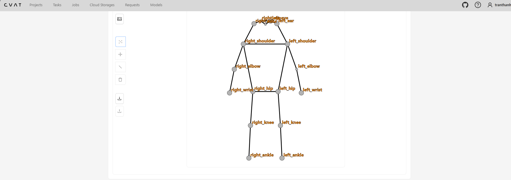
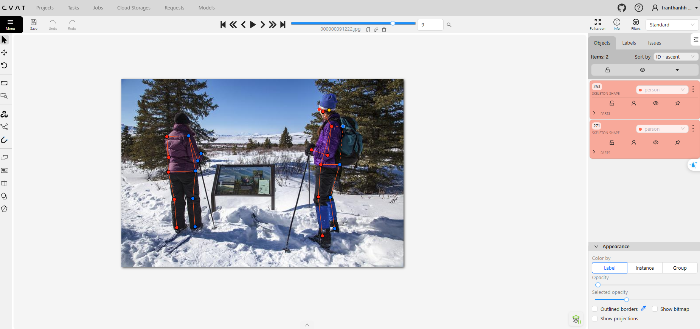
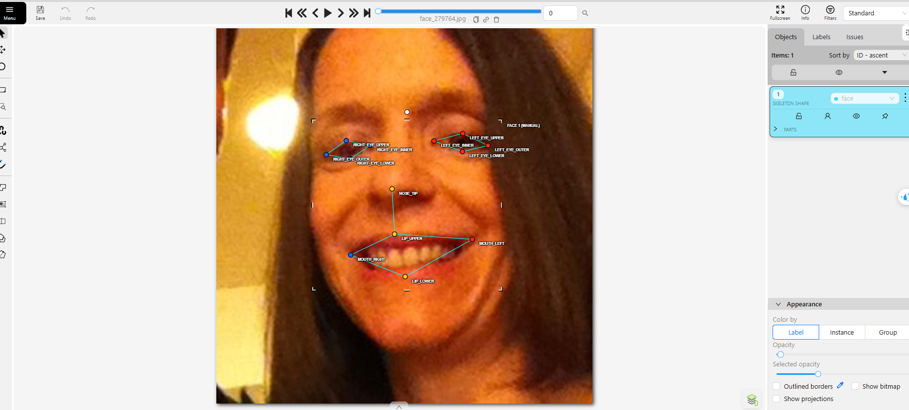
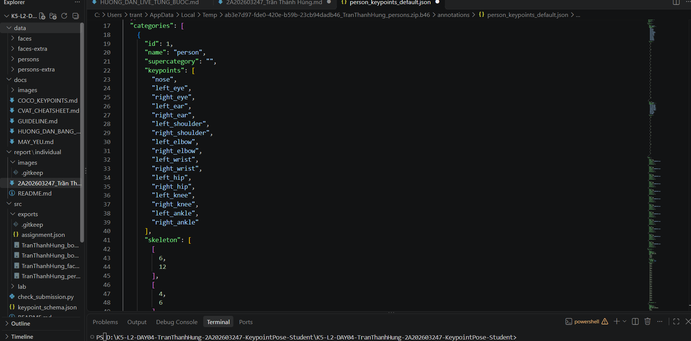

# Báo cáo cá nhân — Trần Thành Hùng — 2A202603247

Dữ liệu báo cáo được đối chiếu từ `src/exports/assignment.json`, các file COCO Keypoints trong `src/exports/` và kết quả chạy `src/check_submission.py`. Những thông tin không thể xác minh từ các file này được đánh dấu để bổ sung, không suy đoán.

## 0. Thông tin học viên

- Họ tên: Trần Thành Hùng
- MSSV: 2A202603247
- Email: Chưa cung cấp
- Link repository: https://github.com/Hung-1812/K5-L2-DAY04-TranThanhHung-2A202603247-KeypointPose-Student/tree/main
- Tài khoản CVAT trong assignment: `tranthanhhung1812`
- Phiên bản CVAT (Help → About): Chưa xác nhận; tài liệu hướng dẫn thao tác của lab được thử trên CVAT 
- Máy: Windows
- Bộ ảnh (`src/exports/assignment.json`): Có
- Giờ bắt đầu / giờ kết thúc: 

## 1. Kiểm tra label (CP0)

| Label | Kiểu | Số điểm | Tên điểm đúng bảng của lab? | Đúng thứ tự? | Số cạnh |
|---|---|---:|---|---|---:|
| `person` | Skeleton | 17 | Có, theo `src/keypoint_schema.json` | Có | 19 |
| `face` | Skeleton | 13 | Có, theo `src/keypoint_schema.json` | Có | 13 |

Mẫu `person` trong cấu hình dựng theo người quay mặt về camera .   
Cách đổi cờ cho một điểm theo hướng dẫn CVAT 2.82 của lab: rê chuột vào đúng điểm rồi nhấn `Q` để bật/tắt `occluded` (`v = 1`), `O` để bật/tắt `outside` (`v = 0`) . 

## 2. Số lượng đã gán và thời gian (CP1, CP2)

| Nhóm ảnh | Số ảnh | Số skeleton đã gán | Số người dưới 60 px (không gán) | Số poster / gương / màn hình bỏ qua | Thời gian (phút) |
|---|---:|---:|---|---|---|
| `easy` | 5 | 5 | 0 | 0 |  |
| `occluded` | 3 | 6 | 0 | 0 |  |
| `back` | 2 | 4 | 0 | 0 |  |
| `small` | 1 | 2 | 0 | 0 |  |
| `crowd` | 1 | 3 | 0 | 0 |  |
| `faces` | 8 | 8 | 0 | 0 |  |


- Số ảnh người đã xong ở mốc phút 105: 20 ảnh
- Thời gian thực tế (phút): CP1 60p · CP2 40p · CP3 50p.
- Ảnh tốn thời gian nhất, vì sao: những ảnh liên quan đến người

## 3. Bảng ca khó (CP1, CP2)

Các dòng dưới đây là những trường hợp script tự kiểm đánh dấu cần xem lại; đây là cảnh báo hình học, không khẳng định annotation sai. Cần mở ảnh tương ứng trên CVAT để xác nhận cặp trái/phải có thực sự bị đổi hay là tư thế bắt chéo.

| Ảnh | Người / mặt | Điểm | Cờ đã chọn | Phân vân giữa | Lý do chọn |
|---|---|---|---|---|---|
| `000000100510.jpg` | Người  | Cặp mắt  | v=0 | lên để occluded hay để outside | do không nhìn thấy mắt nhưng vẫn có thể đoán được mắt nằm ở vị trí nào  |
| `000000122199.jpg` | Người  | Gối, cổ chân | Không xác định từ cảnh báo | `lr_swap` hoặc chân bắt chéo thật |  cặp gối/cổ chân nằm ngược phía; cần lần theo từng chân trên ảnh. |
| `000000122199.jpg` | Người  | `left_shoulder` | `v = 1` | `v = 1` hoặc `v = 0` | Điểm `v = 1` ở sát mép ảnh ; cần xem khớp có nằm ngoài ảnh hay còn ước lượng chắc được. |


## 4. Bảng tự review (CP3)


| Ảnh | Người / mặt | Điểm | Mã lỗi | Ghi chú | Đã sửa? |
|---|---|---|---|---|---|
| 000000196853.jpg | Người | position | position | phân biệt nhầm bên trái phải so với người trong ảnh | đã chỉnh sửa lại bên  |
|000000254060.jpg | Người | bị che khuất nửa người | v=0 | không biết lên để occluded hay để outside cho các phần bị khuất | để v=0 cho các phần bị khuất |


## 5. Kiểm file xuất và kết quả tự kiểm (CP4)

Kiểm mẫu trực tiếp trong JSON bên trong ZIP:

| File | Người / mặt kiểm (ảnh, thứ tự) | Số phần tử `keypoints` | Điểm `outside` ra `v = 0`, `occluded` ra `v = 1`? | `num_keypoints` khớp? |
|---|---|---:|---|---|
| `TranThanhHung_persons.zip` | `000000078170.jpg`, annotation #1 | 51 | Có; `v=0`: 2, `v=1`: 8 | Có; 15 điểm `v>0` |
| `TranThanhHung_persons.zip` | `000000100510.jpg`, annotation #2 | 51 | Có; `v=0`: 3, `v=1`: 2 | Có; 14 điểm `v>0` |
| `TranThanhHung_faces.zip` | `face_294580.jpg`, annotation #1 | 39 | Có; `v=0`: 0, `v=1`: 6 | Có; 13 điểm `v>0` |

Ở các annotation người, điểm `outside` có `v = 0`; điểm `occluded` có `v = 1`. CVAT 2.x giữ tọa độ cũ cho điểm `outside`, không đổi về `0, 0`; script ghi nhận tổng cộng 54 điểm `v = 0` như vậy. Đây là hành vi export được mô tả trong hướng dẫn, không phải lỗi.

Hai job đã chuyển sang completed trên CVAT? Chưa xác minh được từ các file ZIP; cần kiểm tra trạng thái thực tế trên CVAT.

Dán phần **TÓM TẮT** từ lần chạy `python src\check_submission.py --persons src\exports\TranThanhHung_persons.zip --faces src\exports\TranThanhHung_faces.zip`:

```text
----- TÓM TẮT (dán vào báo cáo mục 5) -----
- File person: TranThanhHung_persons.zip
  Số ảnh: 12 · số skeleton `person`: 20 · mỗi annotation 51 số
  Skeleton theo ảnh: 000000027565=1, 000000078170=2, 000000100510=2, 000000122199=2, 000000162046=1, 000000225138=1, 000000272026=3, 000000294329=1, 000000294379=1, 000000391222=2, 000000467300=2, 000000480582=2
  Cờ v: v=2 238 (70%) · v=1 48 (14%) · v=0 54 (16%)
  num_keypoints trung bình: 14.3
- File face: TranThanhHung_faces.zip
  Số ảnh: 8 · số skeleton `face`: 8 · mỗi annotation 39 số
  Skeleton theo ảnh: face_279764=1, face_294580=1, face_345145=1, face_421231=1, face_442231=1, face_469647=1, face_505385=1, face_575921=1
  Cờ v: v=2 98 (94%) · v=1 6 (6%) · v=0 0 (0%)
  num_keypoints trung bình: 13.0
- Ghi chú: 54 điểm v = 0 vẫn mang tọa độ cũ (CVAT 2.x xuất như vậy; chuẩn COCO ghi 0, 0). Không phải lỗi: điểm v = 0 bị bỏ qua khi huấn luyện và khi chấm.
- Số [LỖI]: 0 · số [CẢNH BÁO]: 5
Kết quả: ĐẠT (đọc lại từng cảnh báo ở trên)
```

Các `[CẢNH BÁO]` còn giữ nguyên và lý do:

- `000000100510.jpg` #2: cặp mắt có thể bị đổi trái/phải hoặc là tư thế thật.
- `000000122199.jpg` #1: cặp gối/cổ chân có thể bị đổi trái/phải hoặc chân bắt chéo.
- `000000122199.jpg` #2: `left_shoulder` mang `v = 1` nằm sát mép `(479, 211)`; cần xác nhận lại cờ.
- `000000225138.jpg` #1: cặp cổ chân có thể bị đổi trái/phải hoặc chân bắt chéo.
- `000000480582.jpg` #2: cặp gối/cổ chân có thể bị đổi trái/phải hoặc chân bắt chéo.


## 6. Ảnh chụp màn hình

Thư mục `report/individual/images/` hiện chưa có ảnh chụp (chỉ có `.gitkeep`). 

1. Label `person` trong label constructor, đủ 17 điểm có tên:

   

2. Một người quay lưng đã gán, thấy cờ visibility:

   

3. Một khuôn mặt đã gán 13 điểm, phóng to vùng mắt:

   

4. Một đoạn JSON export của một người:

   


## 7. Tự đánh giá


1. Lỗi/cảnh báo cần chú ý nhất là trái/phải ở các cặp mắt, gối và cổ chân. Để tránh lỗi trong dự án thật, xác định hướng người trước, lần theo từng chi từ khớp gần thân ra đầu chi, rồi kiểm tra lại các cặp trái/phải trước khi lưu.

2. Đề xuất thêm vào guideline: với các tư thế bắt chéo, yêu cầu kiểm tra mỗi bên bằng cách lần theo chuỗi vai–khuỷu–cổ tay hoặc hông–gối–cổ chân; không kết luận đổi trái/phải chỉ dựa vào vị trí hai bàn tay/bàn chân trên ảnh.

3. Nếu nhãn trái/phải bị đổi, model sẽ nhận tọa độ khớp đúng nhưng gán sai tên keypoint. Khi lật ảnh để tăng dữ liệu, cặp trái/phải còn bị hoán đổi thêm lần nữa; điều này làm mục tiêu heatmap/loss không nhất quán. 

## 8. Khó khăn và lỗi kỹ thuật

Script kiểm tra hai file chính báo **0 lỗi, 5 cảnh báo**, kết quả `ĐẠT`. Các cảnh báo liên quan đến các cặp trái/phải có thể bị ngược và một điểm vai sát mép ảnh. 

## Bonus (nếu làm)

### B1 — 3 ảnh người khó thêm

| Ảnh | Số skeleton | Số người dưới 60 px | Ca khó nhất |
|---|---:|---|---|
| `000000125998.jpg` | 3 | 0 | 0 |
| `000000196853.jpg` | 3 | 0 | 0 |
| `000000254060.jpg` | 2 | 0 | 0 |

Kết quả `src/check_submission.py` cho `TranThanhHung_bonus_persons.zip` (chạy với `--expected-person-images 3`):

```text
----- TÓM TẮT -----
- File person: TranThanhHung_bonus_persons.zip
  Số ảnh: 3 · số skeleton `person`: 8 · mỗi annotation 51 số
  Skeleton theo ảnh: 000000125998=3, 000000196853=3, 000000254060=2
  Cờ v: v=2 67 (49%) · v=1 12 (9%) · v=0 57 (42%)
  num_keypoints trung bình: 9.9
- Ghi chú: 57 điểm v = 0 vẫn mang tọa độ cũ (CVAT 2.x xuất như vậy; chuẩn COCO ghi 0, 0). Không phải lỗi: điểm v = 0 bị bỏ qua khi huấn luyện và khi chấm.
- Số [LỖI]: 0 · số [CẢNH BÁO]: 0
Kết quả: ĐẠT
```

### B2 — 5 ảnh khuôn mặt đen trắng / hồng ngoại

Đã có export 5 ảnh, mỗi ảnh 1 skeleton 13 điểm. Script tự kiểm báo 0 lỗi, 0 cảnh báo (`ĐẠT`); tổng cộng `v = 2`: 61 điểm, `v = 1`: 4 điểm, `v = 0`: 0 điểm. Bốn điểm `v = 1` thuộc annotation `face_68290.jpg`.

Ảnh không màu làm giảm thông tin màu để phân biệt chi tiết mắt, da, môi và vùng tối; cần dựa nhiều hơn vào biên dạng, cấu trúc và vị trí tương đối. Kính râm vẫn dùng `v = 1` nếu mắt bị che nhưng có thể ước lượng vị trí chắc chắn từ gọng/biên kính; nếu không thể ước lượng đáng tin cậy thì dùng `v = 0`.

### B3 — Model so với nhãn của tôi (không tính điểm)

- Demo đã dùng: 
- Ảnh đã thử:

1. Model có trả điểm cho khớp bị che hoặc ngoài ảnh không, confidence thế nào? Chưa thử.
2. Với người quay lưng, model có đổi trái/phải không? Chưa thử.
3. Bộ điểm của model có giống 17 điểm COCO không? Chưa thử.

## 9. Tài liệu tham khảo và công cụ AI đã dùng

- Quy ước nhãn và thao tác: `docs/GUIDELINE.md`, `docs/CVAT_CHEATSHEET.md`, `docs/COCO_KEYPOINTS.md`.
- Công cụ: CVAT và `src/check_submission.py`; chạy script và điền các số liệu kiểm chứng vào báo cáo.
